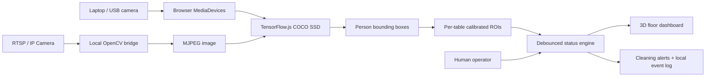

# TableSight — Architecture & System Boundaries

**Version:** 1.0.0 prototype  
**Owner:** Md Najmul Hossain

## Context

The front end is a self-contained JavaScript client containing a simulation engine, optional browser inference, and a 3D-effect visual interface.

## Logical modules

| Module | Where | Responsibility |
|---|---|---|
| Digital twin | `docs/app.js` | 12 tables, states, 3D visual rendering |
| Source manager | `docs/app.js` | Browser video permission or same-origin MJPEG |
| Detector | COCO-SSD + TFJS in browser | Person boxes, configurable confidence |
| Calibrator | `docs/app.js` | Rectangular ROI in normalized (0..1) frame coordinates |
| State transitions | `docs/app.js` | Two positive frames before occupied; four negative frames before cleaning |
| Operator controls | `docs/index.html` | Explicit status override/confirmation |
| Local relay | `bridge/server.py` | Optional camera acquisition, no persistent footage |
| Event display | `docs/app.js` | In-memory recent events, resets on refresh |

## State safety

- Unmapped tables are `unmonitored` once AI starts. This avoids reporting unobserved tables as definitely free.
- Calibrated empty zones become available after sustained negative detections. This is a heuristic, not ground-truth.
- Once a detected guest leaves, `occupied` → `cleaning` after four negative inference frames.
- Cleaning → available occurs **only** after a human manual confirmation.
- Manual `reserved` tables do not transition automatically to occupied; a staff member may override.
- Person-center-in-ROI is a **proximity proxy**, not precise seated-guest verification; staff walking through the seating zone can trigger false events.

## Data-flow and privacy threat boundaries

- Browser camera frames never leave the browser through this application.
- IP video transits the local bridge and browser RAM; it is not saved.
- The optional TensorFlow model and scripts are fetched from third-party hosting on initial activation; no camera frames are intentionally uploaded by the application. For strict private deployments, self-host audited assets and disable external network access.
- No identity, faces, customer account, payments, biometric identifiers or cloud API calls are stored.
- Browser tab refresh clears zones, demo state, inference results and events.
- The optional relay is intended **only** for loopback. No authentication has been designed for remote access.
- Production requires authenticated HTTPS, per-role access, audit trails, secure camera secrets, access control, retention policy, and compliance review.

## Scale and benchmark plan

Measure person detector precision/recall, table state precision/recall, per-table turnaround latency, operator override frequency, camera reconnect behavior, missing frame tolerance, and performance on integrated/non-integrated GPUs. Capture ground-truth occupancy labels with explicit consent, including empty rooms, partial occlusions, reflective surfaces, changing light, and staff transit.
